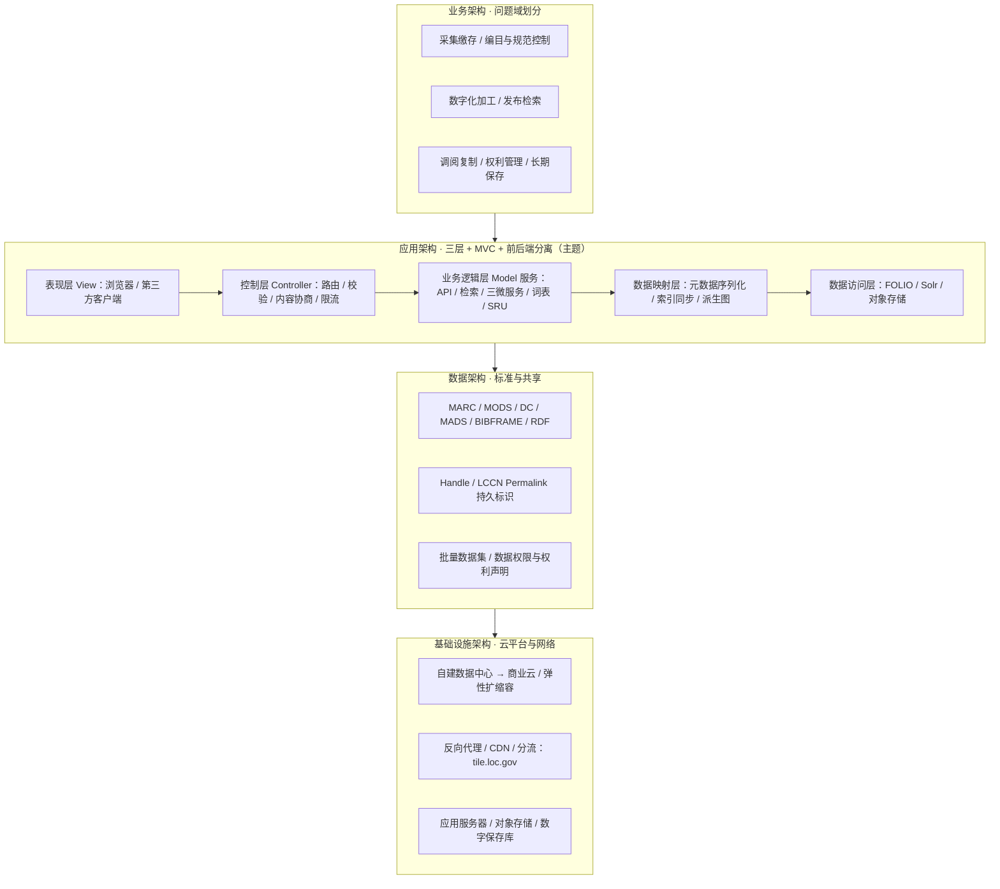
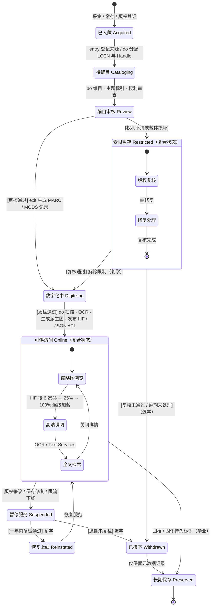
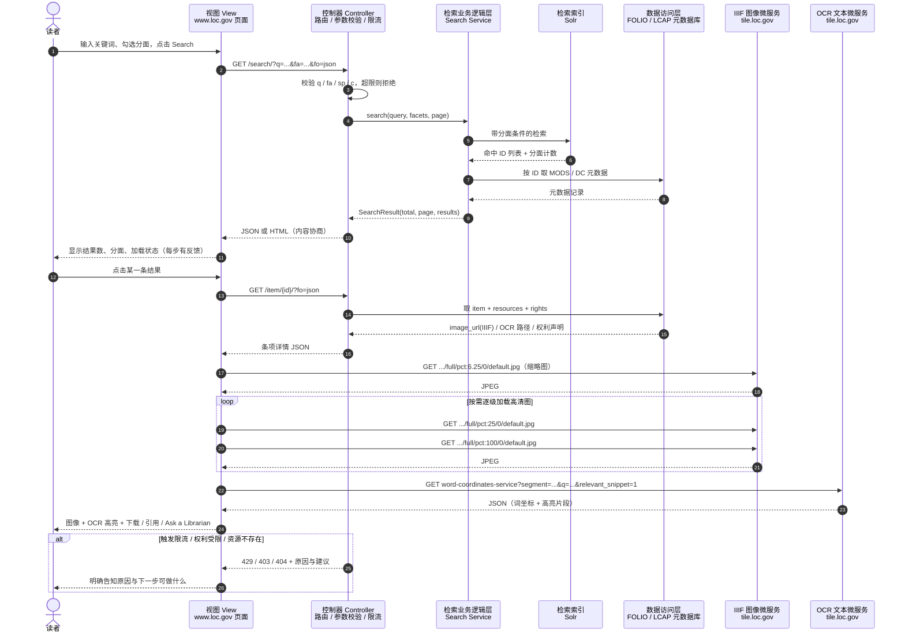
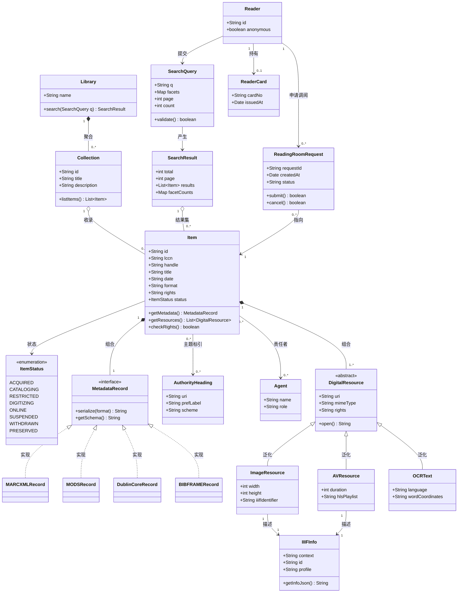
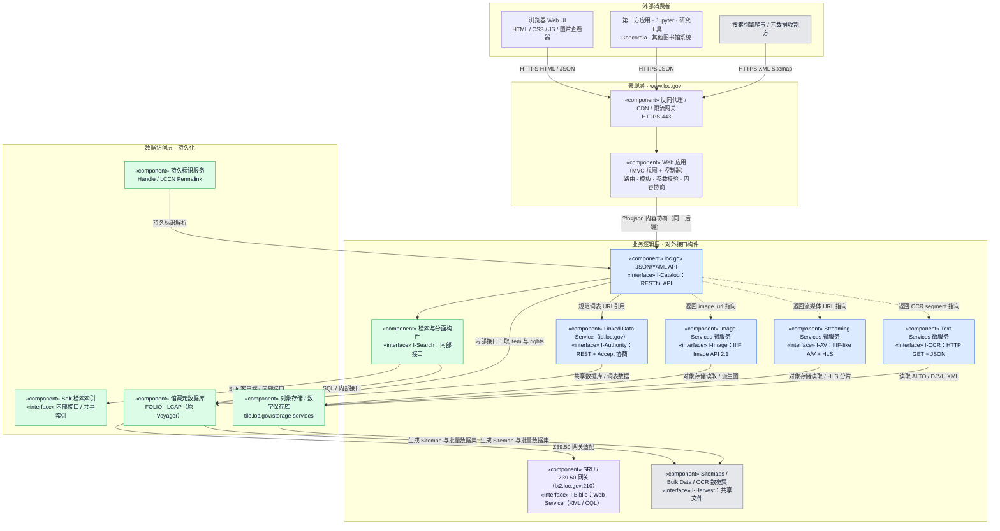

# 美国国会图书馆网站（loc.gov）软件架构、UML 建模与接口技术分析

> 课程作业｜对照《领域对象建模 / 系统应用架构设计 / 接口层设计》课堂内容
> 分析对象：把 **loc.gov 视为"扩大版的公开图书馆管理系统"**
> 分析日期：2026-11-13｜依据：美国国会图书馆官方公开文档 + 网站实际浏览

---

## 摘要（结论先行）

1. **架构层面**：loc.gov 不是单体网站，而是按 **业务 / 数据 / 应用 / 基础设施** 四层展开的、跨多个二级域名部署的**分布式系统**；应用架构以 **三层架构 + MVC + 前后端分离** 为骨架，对外表现为 **面向服务（SOA）与局部微服务并存** 的混合形态，并保留 Voyager 等遗留单体。
2. **四张 UML 图**：以"数字馆藏条目 Item"为对象画状态图（对标课堂"学籍管理"），以"一次检索并调阅数字化馆藏"画顺序图，以馆藏领域概念画类图，以"构件 + 接口 + 协议"画构件图。
3. **接口技术判定（作业核心）**：构件图中的对外接口属于课堂所讲的 **外部接口（API）中的「直接接口」，具体是 Web Service / RESTful API 一族——基于 HTTP/HTTPS、用 URL 定位远程服务接口**；此外还有 **间接接口「共享文件」**（Sitemap、批量数据集、OCR/原文件下载）和内部 **共享数据库 / 内部接口**（FOLIO、Solr、对象存储）。
4. **明确未采用**：课堂案例中的 **Java RMI（1099 端口）、RPC、Thrift、CORBA/IDL** 均未在 loc.gov 公开接口中出现。同为"系统间取数据"，学籍案例用 RMI，loc.gov 用 HTTP REST，差异的根因是**网络范围、客户端异构性、契约形态与可缓存性**不同（详见第五节）。

---

## 一、分析对象与事实依据

### 1.1 可观测的系统清单（这一步相当于课堂的"业务架构：问题域模块化划分"）

| 域名 / 子系统 | 职责 | 课堂对应概念 |
| --- | --- | --- |
| `www.loc.gov` | 主站页面、统一检索、条项页；同时是 JSON/YAML API 宿主 | 表现层 + 控制器 + API 外观 |
| `tile.loc.gov` | Image / Text / Streaming 三个微服务 + `storage-services` 原文件 | 业务逻辑层（专用构件）、分布式部署 |
| `id.loc.gov` | 规范控制与词表的关联数据服务（LCSH、名称、MADS、SKOS） | 数据架构：标准数据表达 / 数据共享平台 |
| `lx2.loc.gov:210` | SRU / Z39.50 网关，面向其他图书馆系统 | SOA：跨机构、跨平台集成 |
| `catalog.loc.gov` | 公共目录，2025-06-30 起由 FOLIO / LCAP 驱动 | 数据访问层（遗留 Voyager → 新平台） |
| `lccn.loc.gov` / Handle | 持久标识符（LCCN Permalink、Handle） | 数据架构：数据标准与标识 |
| `chroniclingamerica.loc.gov` | 历史报纸，2025 年起并入 loc.gov API，保留 OCR 批量数据 | 间接接口：共享文件 |
| `api.congress.gov` / PPOC / NLS BARD | 立法数据、图片目录、盲人图书馆等独立 API | 外部接口（各自独立的 API） |

> 官方原文：*"The loc.gov API provides structured data about Library of Congress collections. The API was originally designed to power the loc.gov website, but in addition to providing HTML for the website it can provide a wealth of information in JSON format."*
> 这句话是判定 **前后端分离 / 同一后端支撑多前端** 最直接的证据。

### 1.2 官方公开的三大类 API 与附加服务

- **JSON/YAML for loc.gov**：`https://www.loc.gov/{endpoint}/?fo=json`（`fo=yaml` 切 YAML）；端点含 `/search/`、`/item/{id}/`、`/resource/{id}/`、`/collections/{name}/`、`/photos/` 等；参数 `q`、`fa`（分面）、`sp`（页码）、`c`（每页条数）、`at` 等；**无需 API key / 无认证**，但强制限流，且深分页不得超过第 100,000 条。
- **Sitemaps**：XML 文件，供搜索引擎与爬虫自动交互。
- **Microservices**（官方用词）：Text Services（OCR 全文、词坐标、上下文片段）、Image Services（IIIF 兼容）、Streaming Services（音视频交付）。官方定义为 *"a limited-purpose computer system written to carry out a specific role and using a lightweight API"*——与课堂"单一职责、相对简单的业务单元"的微服务定义完全吻合。
- **Additional APIs**：Congress.gov API、NLS BARD、Chronicling America、PPOC JSON HTTP API、Linked Data Service、SRU。

---

## 二、IT 系统四层架构分析

> 课堂辨析：**架构是宏观、无形、全局的高层决策（文章的中心思想与提纲）；结构是有形、具体的实现细节（段落与细节）**。下文先讲架构决策，第四节的构件图才落到具体结构与接口。

### 2.1 业务架构

- **问题域模块划分**：采集与缴存 → 编目与规范控制 → 数字化加工 → 发布与检索 → 阅览室调阅 / 复制下载 → 权利管理 → 长期保存；另有面向公众、研究者、国会、馆员、机器（API 消费者）的多条业务线。
- **领域建模**：核心对象是 `Item`（馆藏条目）与 `Collection`（专题集合），围绕它们组织 `MetadataRecord`、`AuthorityHeading`、`DigitalResource`、`SearchQuery`、`ReadingRoomRequest`（详见 4.3 类图）。
- **架构决策**：把"内容"当作可被人和机器共同消费的**资源**，而非某个页面；因此才有统一 API、持久 URI 与标准元数据格式。

### 2.2 数据架构

| 要素 | loc.gov 的实现 |
| --- | --- |
| 标准数据表达 | MARC 21 / MARCXML、MODS、Dublin Core、MADS、BIBFRAME、EAD、ALTO XML、DJVU XML、RDF / SKOS / JSON-LD、IIIF `info.json` |
| 数据库 / 平台 | FOLIO 开源图书馆服务平台（LCAP 项目，2022 选型，2025-06 新公共目录上线），此前为 Voyager 10.3（Oracle），历史上 ILS 含约 2000 万书目、1100 万规范记录 |
| 检索索引 | Solr 全文 / 分面索引（LC 的开源项目 chronam 即 Django + MySQL + Solr） |
| 数据共享平台 | `id.loc.gov` 关联数据、`lccn.loc.gov` 与 Handle 持久标识、批量数据集（RDF/XML、N-Triples、OCR、CSV） |
| 数据权限管理 | 每条 item 带 rights / Rights Advisory；受限资料走 Stacks 阅览室访问；API 限流与深分页阈值 |

### 2.3 应用架构（本课程主题）

| 三层架构 | loc.gov 对应构件 | 说明 |
| --- | --- | --- |
| 表现层 | 浏览器 Web UI（首页、检索框、分面、条项页、图片查看器、播放器）、第三方 App / Jupyter / 小程序式客户端 | 给用户提供访问入口；多端复用同一后端 |
| 业务逻辑层 | loc.gov JSON/YAML API、检索与分面构件、权利校验、Text / Image / Streaming 三微服务、Linked Data Service、SRU 网关 | 对业务数据做逻辑处理（课堂"借书组件、查询组件"的放大版） |
| 数据访问层 | FOLIO / LCAP 元数据库、Solr 索引、对象存储与数字保存库、持久标识服务 | 完成数据增删改查与文件存取 |

**多层扩展（课堂原话的落地）**：loc.gov 在表现层与领域层之间加入了**控制层 / 中介层**（反向代理、限流网关、路由与 `fo=json` 内容协商）；在领域层与数据访问层之间加入了**数据映射层**（MARCXML / MODS / DC ↔ JSON、Solr 索引同步、IIIF 派生图生成）。因此它实际是"三层 → 五层"的多层结构，正是课堂所讲"通过封装可灵活决定部署一层、两层还是多层"。

**MVC 映射与辨析**：

- **Model（数据）**：`Item` / `Collection` / `MetadataRecord` 领域模型 + FOLIO 元数据库 + Solr 索引 + 对象存储。
- **View（外在表现）**：HTML 页面、条项模板、IIIF 图片查看器；以及第三方客户端把同一份 JSON 渲染成自己的界面。
- **Controller（纽带）**：`/{endpoint}/` 路由、`q/fa/sp/c` 参数校验、限流、`fo=json` 内容协商、按请求决定返回 HTML 还是 JSON、放行还是拒绝。
- **流程对照**：课堂 GitHub 登录案例中"视图把数据发给模型比对，成功返回登录成功界面，否则提示错误、控制器决定放行或拒绝"；loc.gov 中"检索请求 → 控制器校验 → 模型（检索服务 + 索引 + 元数据库）→ 返回结果或 429/403 提示 → 视图渲染"是同一骨架。
- **值得指出的差异**：课堂描述的流程里"视图可直接访问模型查询数据"，而在**前后端分离**之后，视图不再直连模型，请求先到控制器与 API，视图只消费 JSON 再渲染。这是 MVC 在现代 Web 下的常见变体（Controller-first），也解释了为什么"表现层"与"业务逻辑层"能彻底解耦。

**前后端分离的收益（课堂观点的实证）**：官方明确说明该 API 原本就是为驱动 loc.gov 网站而设计，同时对外公开。于是同一后端可同时供给：网页版 loc.gov、Concordia 众包转录平台（Python-Django-Postgres，调用 loc.gov API 取元数据与 JPEG）、Jupyter / 研究者脚本、第三方 App、搜索引擎爬虫。反过来，若像早期那样把页面与数据绑死，每增加一种前端就得重做一遍——正是课堂所说的"原本做静态网页，后来要变小程序，工作量大大增加"。

### 2.4 基础设施架构

- **多域名分布式部署**：`www` / `tile` / `id` / `lx2` / `catalog` / `lccn` / `chroniclingamerica` / `congress` 分属不同主机与服务，媒体与图片走独立域名 `tile.loc.gov`，相当于课堂所讲的"网络分流代理 + 外部服务器 / 应用服务器 / 存储服务器"分工。
- **云化与弹性**：FY2026 预算文件明确提出把 loc.gov、congress.gov、copyright.gov 从自建数据中心迁移到商业云，采用 cloud-native、auto-scaling、按需增减带宽与算力；把历史磁带库替换为**对象存储**，并在本地与云之间建立冗余。这正是课堂"云平台、机房网络拓扑、存储服务器"层面的全局决策。
- **缓存友好设计**：IIIF 服务刻意把参数放在 **URL 路径段**而非查询串（`/{region}/{size}/{rotation}/{quality}.{format}`），官方说明理由是"更容易缓存、可用预生成文件实现最小部署"——基础设施决策反过来决定了接口形态。

### 2.5 四层架构总览图

---

## 三、架构模式与设计模式的判定

> 课堂定义：架构模式是"对有相似关注点的系统的总结和抽象，本质是经验复用"。下表逐条判定 loc.gov 用了哪些、以及为什么。

| 课堂所讲模式 | loc.gov 是否采用 | 证据 / 说明 |
| --- | --- | --- |
| 分层模式 / 三层架构 | ✅ 采用，并扩展为多层 | 见 2.3 映射表；表现层、业务逻辑层、数据访问层清晰可辨 |
| MVC 模式 | ✅ 采用（Controller-first 变体） | 路由 + `fo=json` 内容协商充当控制器；同一模型输出 HTML 与 JSON |
| 前后端分离 | ✅ 强证据 | API 原本为驱动网站而建，同时对外公开；Concordia 等第三方复用 |
| 单体式系统 | ⚠️ 遗留存在 | Voyager ILS + 早期自建数据中心；官方称现有数字馆藏系统"十余年迭代、需标准化整合与现代化" |
| 分布式系统 | ✅ 采用 | 按域名 / 职责拆分到多台服务器；媒体流与页面分离 |
| SOA 面向服务架构 | ✅ 用于跨机构集成 | SRU / Z39.50、MARC 分发、批量数据集，服务于"跨企业、跨行业"的图书馆界元数据交换 |
| 微服务架构 | ✅ 局部采用 | 官方明确命名 Text / Image / Streaming 三个 microservices，单一职责 + 轻量 API；FOLIO 亦为模块化平台 |
| 六边形 / 洋葱 / CQRS | ❌ 无公开证据 | 不臆断 |

**取舍分析（对照课堂的优缺点讨论）**：loc.gov 并非"全盘微服务"，而是**分布式 + 面向服务 + 局部微服务 + 遗留单体共存**的混合体。拆分的动因与课堂"方志系统按省拆分"同理：体量太大（数千万条书目、上亿页报纸、PB 级数字保存），单一应用无法承载不同媒体类型的处理与带宽。代价也如课堂所言"服务数量多，测试部署管理工作量增大，性能和可用性可能下降"——官方预算自述遗留系统需标准化整合、必须做限流与深分页上限、并依赖云弹性与 CDN 来兜住性能和可用性。

### 3.1 软件框架与好莱坞法则

> 课堂：框架是半成品平台（预制菜），遵循"别找我们，我们找你"（好莱坞法则），框架扮演主程序、协调控制流程；开发三步走 = 定架构 → 选框架 → 基于框架写程序。

- **FOLIO / LCAP**：LC 于 2022 选定开源图书馆服务平台 FOLIO 作为新馆藏访问平台基础，合同由 EBSCO 实施，并按自身业务做定制扩展（部署 LCSG、NLS、CRS 三个实例）。这正是"选一个现成半成品平台，再按需求填空"。
- **Django（课堂点名的 Python 框架）**：LC 开源的 `chronam`（Chronicling America，Django + MySQL + Solr）与 `Concordia`（容器化 Python-Django-Postgres，部署在云，调用 loc.gov API 取元数据与 JPEG）是实证。URL 路由 → 视图 → 模板渲染的整体流程由框架控制，开发者只实现业务——典型的好莱坞法则。
- **IIIF / SRU 是"标准化接口框架"**：LC 没有自己发明图片缩放协议，而是遵循 IIIF Image API 2.1 与 SRU/CQL；相当于在接口层复用了行业级"预制菜"。
- **IoC / AOP 的类比**：课堂讲 Spring 的 IoC（对象由容器创建注入）与 AOP（事务、日志、权限控制等横切逻辑从业务模块中分离）。loc.gov 中，限流、访问控制、CORS、内容协商、缓存、日志这些**每个服务都需要但不属业务**的逻辑，被上提到网关 / 框架 / 微服务基础设施统一处理，业务构件只管"检索、取图、取 OCR"。这是 AOP 思想在架构层的体现。

### 3.2 其他可辨识的设计模式

| 模式 | 落点 |
| --- | --- |
| 外观 Facade | `/apis/` 统一门户与 JSON API 把内部 FOLIO、Solr、对象存储的复杂性收敛为一个 `?fo=json` 入口 |
| 代理 / 适配器 Proxy & Adapter | `lx2.loc.gov` 的 MetaProxy 把传统 Z39.50 数据库适配成基于 HTTP 的 SRU/CQL 服务；反向代理 / CDN |
| 策略 Strategy | `recordSchema=mods / marcxml / dc / mads` 与 HTTP `Accept` 内容协商决定同一资源序列化成哪种格式 |
| 观察者 / 发布订阅 Observer | Sitemap、ATOM 更新 feed（`id.loc.gov/.../feed/1`）、数据集更新供外部订阅与收割 |
| 仓库 / 数据映射 DAO & Data Mapper | 数据访问层与各元数据格式 ↔ JSON 的映射层 |
| 无状态资源 + 缓存 | IIIF 参数全部进 URL 路径段，便于 CDN 缓存与预生成文件 |

---

## 四、四张 UML 图

### 4.1 状态图：数字馆藏条目 Item 的生命周期

> 课堂要求：状态图描述**单个对象**在生命周期内因外部事件产生的状态转换；含初态（实心圆）、终态（实心圆加圈）、简单状态、复合状态、`entry` / `exit` / `do` 三种内部行为。
> 此处刻意与课堂"学籍管理"案例一一对应，便于对照检查。

**元素对照表**

| 课堂元素 | 本图落点 |
| --- | --- |
| 初态 / 终态 | `[*] --> 已入藏` / `长期保存 --> [*]` |
| 简单状态 | 已入藏、待编目、编目审核、数字化中、暂停服务、恢复上线、已撤下、长期保存 |
| 复合状态 | 「受限暂存」内含版权复核 / 修复处理；「可供访问」内含缩略图浏览 / 高清调阅 / 全文检索 |
| `entry` / `exit` / `do` | `entry 登记来源`、`exit 生成 MARC / MODS`、`do 编目 · 主题标引 · 权利审查`、`do 扫描 · OCR · 派生图` |
| 事件 / 守卫条件 | 采集、审核通过、权利不清、质检通过、版权争议、限流下线；`[审核通过]`、`[一年内复检通过]` |

**与"学籍管理"案例的映射（课堂对照）**

| 学籍案例 | loc.gov 数字馆藏 | 说明 |
| --- | --- | --- |
| 入学（入学报到） | 入藏（采集 / 缴存） | 对象进入系统 |
| 复查合格注册 | 编目审核 / 权利审查 | 不通过则不能进入"正常"状态 |
| 正常学习（上课、考试） | 可供访问（浏览、调阅、全文检索） | 对象对外提供价值的稳态 |
| 休学（查出传染性疾病） | 受限暂存 / 暂停服务（版权、修复、限流） | 中止服务但保留对象 |
| 休学一年后复学 → 正常学习 | 复检通过 → 恢复上线 → 可供访问 | 可回流的状态 |
| 逾期未复学 → 退学 | 逾期未复检 → 已撤下 | 不可回流的分支 |
| 毕业 → 终态 | 长期保存 → 终态 | 生命周期终点 |

**状态反馈与用户体验（呼应课堂"登录无提示"的反面案例）**：状态转换必须在 HCI 层有可见反馈——检索中的加载指示、结果数 / 分面计数、`No known restrictions` 之类的权利声明、429 限流与 403 受限的明确提示、下载进度。若"点击检索后页面无任何提示"，用户无法区分是系统无响应、被限流还是无结果，正是课堂所批评的设计缺陷。状态图与顺序图、用例图相互参照，可用来检查每个状态是否都有对应界面反馈，起到查漏补缺作用。

### 4.2 交互图（顺序图）：一次检索并调阅数字化馆藏

**读图要点**：

- 生命线自左至右正好是 **表现层 → 控制层 → 业务逻辑层 → 数据访问层**，与三层（多层）架构一一对应；`Img` / `Txt` 是分布式部署的独立构件，通过 HTTP 交互而非本地方法调用。
- `loop` 对应 IIIF 按分辨率渐进加载；`alt` 对应异常分支。**每一条请求消息都有返回消息**，即课堂强调的"交互反馈"。
- 与状态图互补：状态图描述 **Item 对象** 的状态，顺序图描述 **多个对象之间的消息传递**；两者与用例模型（"检索并调阅馆藏"用例）互相参照，可发现例如"暂停服务状态下条项页该显示什么"这类遗漏。

### 4.3 类图：领域对象建模

**建模说明（对照课堂"业务架构 → 领域建模"）**

| 关系类型 | 图中体现 | 业务含义 |
| --- | --- | --- |
| 组合（强拥有） | `Item *-- MetadataRecord`、`Item *-- DigitalResource` | 元数据与数字文件随条目存在，条目撤销则不再对外提供 |
| 聚合（弱拥有） | `Collection o-- Item`、`SearchResult o-- Item` | 一个条目可属于多个专题集合，也可出现在多个结果集中 |
| 泛化 / 实现 | 四种元数据记录实现 `MetadataRecord` 接口；三类数字资源继承 `DigitalResource` | 对应"策略模式"：同一资源按 `recordSchema` 或 `Accept` 序列化为不同格式 |
| 关联 | `Item -- AuthorityHeading`、`Item -- Agent`、`ReadingRoomRequest -- Item` | 规范控制与调阅业务 |
| 枚举 | `ItemStatus` | 与 4.1 状态图的状态集合严格一致，保证静态模型与动态模型可相互校验 |

### 4.4 构件图（作业重点）：构件、接口与协议

> 课堂：构件图描述系统由哪些软件构件组成、构件之间**采用什么接口**获取信息；学籍案例中用构件图标注"RMI 协议、1099 端口"。下图按同样方式，给每条连线标注协议、端口与数据格式。

**构件与接口清单（把图上标注落成文字）**

| 构件 | 提供的接口 | 真实 URL / 端点样式 | 协议与端口 | 数据格式 |
| --- | --- | --- | --- | --- |
| loc.gov JSON/YAML API | `I-Catalog` | `https://www.loc.gov/search/?fo=json&q=...&fa=...`；`/item/{id}/?fo=json`；`/collections/{name}/?fo=json` | HTTPS / 443，HTTP GET | JSON、YAML（内容协商参数 `fo`） |
| Image Services | `I-Image` | `https://tile.loc.gov/image-services/iiif/{id}/full/pct:25/0/default.jpg`；`{id}/info.json` | HTTPS / 443，IIIF Image API 2.1 | JPEG / JP2 / JSON |
| Text Services | `I-OCR` | `https://tile.loc.gov/text-services/word-coordinates-service?segment=...&format=alto_xml&full_text=1` | HTTPS / 443，HTTP GET + query | JSON（词坐标、全文、片段） |
| Streaming Services | `I-AV` | `https://tile.loc.gov/streaming-services/iiif/{id}/full/full/0/full/default.mp4`、`.m3u8`、`.ts`、`.vtt` | HTTPS / 443，HLS | MP4 / MP3 / WebVTT / HLS |
| Linked Data Service | `I-Authority` | `http://id.loc.gov/authorities/subjects/sh00000011` + `Accept: application/json`；`/feed/1` | HTTP / HTTPS，内容协商 | RDF/XML、N-Triples、JSON-LD、Turtle、ATOM |
| SRU / Z39.50 网关 | `I-Biblio` | `http://lx2.loc.gov:210/LCDB?version=1.1&operation=searchRetrieve&query=...&recordSchema=mods` | **HTTP 端口 210**（SRU over Z39.50 网关，传统 Z39.50 用 7090） | XML / CQL；`mods`、`marcxml`、`dc`、`mads` |
| Sitemaps / Bulk Data | `I-Harvest` | `sitemap XML`、`chroniclingamerica.loc.gov/ocr/`、`id.loc.gov` 压缩 RDF 下载 | HTTPS 文件下载 | XML、ZIP、CSV、N-Triples、OCR |
| 内部构件 | 内部接口 / 共享数据库 | FOLIO / LCAP、Solr、对象存储、Handle 服务 | 内网协议、数据库客户端、对象存储 SDK | SQL、索引文档、二进制对象 |

---

## 五、接口技术判定（作业核心问题）

### 5.1 先回到课堂的分类框架

- **按内外分**：系统内部部件之间 = 内部接口；系统对外提供给其他系统使用 = 外部接口，俗称 API。
- **按交互方式分**：
  - **直接接口**：RPC、Thrift、RMI、Web Service、RESTful API。
  - **间接接口**：共享数据库、共享文件、消息中间件。
- **课堂案例**：学籍管理系统 ↔ 教委学费系统，用 UML 构建图描述接口；"获取学生成绩接口采用 **RMI 协议、1099 端口号**，寻找到学籍管理系统提供的对象后调用接口获取成绩数据"。

### 5.2 逐条判定构件图中的接口

| 构件图连线 | 内部 / 外部 | 直接 / 间接 | 课堂上对应的种类 | 判定依据 |
| --- | --- | --- | --- | --- |
| 浏览器 / 第三方 → JSON API（`?fo=json`） | **外部 API** | 直接 | **Web Service / RESTful API** | HTTP + URL 定位资源，GET 返回 JSON/YAML，无状态 |
| → Image Services（IIIF） | 外部 API | 直接 | **RESTful API** | 资源化 URL 路径段，`info.json`，HTTP GET |
| → Text Services | 外部 API | 直接 | **RESTful API** | HTTP GET + query string，JSON 响应 |
| → Streaming Services（HLS） | 外部 API | 直接 | **RESTful API / 文件流** | 同一 URI 模板按扩展名返回 `.mp4/.m3u8/.vtt` |
| → id.loc.gov Linked Data | 外部 API | 直接 | **RESTful API + 内容协商** | 可解析 URI + HTTP `Accept` 决定 RDF/JSON-LD |
| → SRU / Z39.50 网关 | 外部 API | 直接 | **Web Service（XML / CQL，带端口）** | `operation=searchRetrieve` + XML，标准协议族；是课程"Web Service"在图书馆行业的具体实例 |
| → Sitemap / Bulk Data / OCR 下载 | 外部 | **间接** | **共享文件** | 不调用对方方法，只读取对方发布的文件 |
| FOLIO ↔ Solr ↔ 对象存储 ↔ API | **内部** | 直接 + 间接 | **内部接口 / 共享数据库（共享索引）** | 组件间调用与共用数据存储 |
| RMI（1099）、RPC、Thrift、CORBA/IDL、消息中间件 | — | — | **未采用 / 无公开证据** | 官方文档未出现；HTTP 443 是唯一对外主通道 |

### 5.3 结论

> **loc.gov 构件图中所采用的接口技术，主体属于课堂所讲的「外部接口（API）」中的「直接接口」，具体是 Web Service 与 RESTful API 一族——基于 HTTP/HTTPS 协议、用 URL 定位远程服务接口**；其中主站 JSON/YAML API、三个微服务、关联数据服务是典型 RESTful API，SRU/Z39.50 是面向服务的 XML Web Service。
> 同时并存两类补充：**间接接口「共享文件」**（Sitemap、批量数据集、OCR / 原文件下载）与**内部接口 /「共享数据库」**（FOLIO、Solr、对象存储）。
> **没有采用**课堂学籍案例中的 Java RMI（1099 端口），也没有 RPC / Thrift / CORBA-IDL 的公开证据。

### 5.4 为什么同一个"接口问题"，答案和课堂案例完全相反

| 对比维度 | 课堂案例：学籍 ↔ 教委学费系统 | 美国国会图书馆 loc.gov | 对接口选型的影响 |
| --- | --- | --- | --- |
| 网络范围 | 校内 / 教育专网，受控环境 | 全球公开互联网 | 公网只放行 80/443，专用端口不友好 |
| 客户端 | 同构 Java 系统，双方都是 JVM | 浏览器、Python/Jupyter、爬虫、其他图书馆系统、移动端 | 必须跨语言、跨平台 |
| 调用形态 | RMI 找远程对象 → 调方法（面向过程 / 对象） | 请求 URL 指向资源 → 返回表示（面向资源） | REST 更贴合"每条馆藏有稳定 URI" |
| 契约 | Java 接口 + 对象序列化 | URL 模板 + JSON/XML/RDF + 标准元数据格式 + HTTP `Accept` | 用**标准数据格式**替代 IDL 解决跨语言（课堂讲 IDL 是为解决"跨语言对象通信"，这里用更轻的办法达成同一目标） |
| 端口 | RMI 1099 | HTTPS 443（SRU 例外：210） | 易穿透防火墙、易被 CDN 缓存 |
| 状态 | 有状态远程对象引用 | 无状态、可缓存、可深分页 | IIIF 特意把参数放进 URL 路径段以便缓存 |
| 课堂归类 | 直接接口 · RPC 家族 | 直接接口 · **Web Service / RESTful 家族** | 两类都属于"直接接口"，只是技术路线不同 |

**三条选型理由**：

1. **异构客户端**：调用方可能是任何语言写的程序。REST + JSON/XML + MARC/MODS/RDF 是语言中立的，而 RMI 把双方绑死在 JVM、Thrift / CORBA 又要求先约定 IDL 并生成桩代码，对"任何人都能来取数据"的公共文化机构不划算。
2. **公网可缓存、可伸缩**：无状态 GET + 稳定 URI + CDN 可缓存，是支撑"每天数亿次 Z39.50/SRU 请求、PB 级图像"的前提；有状态远程对象调用难以水平扩展，也难以被代理缓存。
3. **面向资源的领域本质**：馆藏条目先有持久标识（Handle、LCCN Permalink、id.loc.gov URI），再有 API，天然适合 REST 的资源模型；而跨机构元数据交换属于课堂所说的 SOA 场景，因此保留 SRU/Z39.50 这些行业标准 Web Service 与批量数据集（共享文件）做集成。

---

## 六、接口层设计原则检视（UI 与 HCI）

> 课堂辨析：**UI 是界面本身（侧重画面感）；HCI 是为达成目的所需的整个交互过程**。

| 课堂原则 / 要求 | loc.gov 的实际表现 | 评价 |
| --- | --- | --- |
| 过程清晰简单 | 全站统一检索框 + 左侧分面筛选 + 条项页 + 下载 / 引用；`/apis/` 给机器另一条同样清晰的路径 | ✅ |
| 关键操作有提示和警告 | 每条 item 带 `rights` / Rights Advisory；限流、深分页（>100,000 条）明确提示"请改用分面过滤" | ✅ 且错误提示带建议性 |
| 适应不同水平与习惯、输入最小化 | 普通用户用网页 / Top Searches 热词 / 分面点选；专业用户用 API / SRU / 批量数据；`id.loc.gov` Suggest 2.0 提供自动补全 | ✅ 两套接入口 |
| 数据验证对照越早越好 | `fo` 枚举校验、`q/fa/sp/c` 参数与分页上限校验、`recordSchema` 枚举、`Accept` MIME 校验、IIIF `region/size/rotation` 语法校验 | ✅ 在控制器层前置 |
| GUI 基本元素 | 文本输入框（搜索）、命令按钮（Search / Download）、下拉菜单与分面、卡片（Free to Use 图片卡）、列表框、滚动条、分页、标签页、视频播放器 | ✅ 覆盖课堂列举的多数元素 |
| 字符界面 vs 图形界面 | 面向公众是 GUI；面向机器的是"字符化"的 JSON / XML / RDF 接口 | 两者并存，服务不同"用户" |
| HCI 交互方式多样性 | 键盘 / 触屏（mobile-friendly）、屏幕阅读器（accessible to users with disabilities）、音视频字幕 WebVTT、播放器键盘快捷键 | ✅ 超出纯 UI 的交互过程设计 |
| 输入数据校验方法 | 格式校验（`fo`、IIIF 语法）、界限校验（`c`、`sp`、速率）、数据类型校验（`recordSchema`、MIME）、不匹配校验（item 与 resource 对应关系）、重复校验（持久标识去重） | ✅ |
| 防错与自动识别 | 分面列表选择代替自由输入、规范词表（id.loc.gov）代替手填主题词、LCCN / Handle 自动分配、条码式标识 | ✅ 对应课堂"列表选择输入 / 代码表对账" |
| 模型与原型 | 2016 新首页改版说明强调 mobile-friendly、跨格式统一分面、一致的信息呈现，属线框图 → 原型 → 视觉稿的迭代产物 | 可推断，非官方明示 |

**一个值得记录的实测现象**：直接请求 `https://www.loc.gov/search/?fo=json&q=cats&c=1` 时，可能先返回访问验证页（`Just a moment...`）而非 JSON。这说明**接口层还有一层访问控制 / 限流 / 反滥用**，它是构件图中"反向代理 / 限流网关"的实际行为；也再次印证课堂观点——**任何状态变化都要给用户明确反馈**，否则调用方无法区分"系统无响应""被限流""返回为空"。

---

## 七、结论、取舍与分析局限

**一句话结论**：把 loc.gov 当作放大版的公开图书馆管理系统看，它是以 **三层 / MVC / 前后端分离** 为骨架、以 **分布式 + SOA + 局部微服务** 为部署形态、以 **FOLIO 与 Django 等框架**（好莱坞法则）为开发底座、以 **HTTP 上的 Web Service / RESTful API（外部直接接口）为主、共享文件与共享数据库为辅** 的大型信息系统；其构件图里看不到课堂案例的 RMI 1099，取而代之的是 443 端口上一组用 URL 定位资源的公开 API。

**架构取舍评价**：LC 用"按职责拆域名 + 按媒体类型拆微服务 + 保留行业标准 SOA 接口"换来了多端复用与横向扩展，代价是集成复杂度、限流与一致性治理——这与课堂对微服务缺点、对"相同架构允许结构差异"的判断一致。云化、对象存储、FOLIO 迁移（2024–2026 仍在进行）说明架构是**演进**出来的，不是一次设计定稿。

**分析边界（避免过度推断）**：

- 主站 `www.loc.gov` 的具体源码与 Web 框架未公开，本文对 MVC / 控制器 / 内容协商的描述基于**官方 API 文档可观测行为**的合理推断；Django 与 FOLIO 的证据来自 LC 官方开源项目（`chronam`、`Concordia`）与官方新闻稿，**不等同于主站实现**。
- Streaming Services 官方文档自称原型、部分能力未完全实现；SRU 与 Z39.50 属遗留但仍在线的服务。
- 「构件图」是按课程 UML 语义对真实系统做的**抽象建模**，不是官方发布的部署图；端口、URL、格式均有官方文档支撑，构件边界为教学性归纳。

---

## 附录 A：课程知识点 → loc.gov 实例速查表

| 课堂知识点 | loc.gov 实例 |
| --- | --- |
| 状态图初态 / 终态 / 复合状态 / entry-exit-do | 数字馆藏条目：入藏 → 编目审核 → 数字化 → 可供访问（复合）→ 长期保存 → 终态 |
| 学籍管理案例 | 入学↔入藏、复查注册↔编目审核、正常学习↔可供访问、休学↔受限/暂停、复学↔恢复上线、退学↔已撤下、毕业↔长期保存 |
| 架构 vs 结构 | "把内容当作可被人与机器共同消费的资源"是架构；`?fo=json`、IIIF URL 模板是结构 |
| IT 四层架构 | 业务：采编存用；数据：MARC/MODS/RDF + FOLIO；应用：三层 + MVC；基础设施：云化 + CDN + 对象存储 |
| 三层架构 | 表现层=浏览器页面；业务逻辑层=API/检索/三微服务；数据访问层=FOLIO/Solr/对象存储 |
| 多层扩展（控制层、数据映射层） | 限流网关与 `fo=json` 内容协商；元数据序列化与索引同步 |
| MVC | 路由/参数校验=Controller，页面=View，Item/MetadataRecord + 数据库=Model |
| GitHub 登录案例 | 检索请求由控制器校验、模型比对、成功返回结果页，失败 429/403 明确提示 |
| 前后端分离 | 同一 API 既生成 loc.gov 网页，又供 Concordia、Jupyter、第三方 App 使用 |
| 单体 → 分布式 | Voyager 单体 → 按 www/tile/id/lx2/catalog 多域名分布 |
| SOA | SRU / Z39.50、MARC 分发、批量数据集用于跨机构集成 |
| 微服务及代价 | Text / Image / Streaming 三微服务；限流、深分页上限、云弹性、集成治理成本 |
| 框架 + 好莱坞法则 | FOLIO（LCAP）、Django（chronam / Concordia）、IIIF/SRU 标准接口框架 |
| IoC / AOP | 限流、鉴权、CORS、内容协商、缓存上提到网关统一处理 |
| UI vs HCI | 页面是 UI；从检索到调阅、放大、OCR、下载、问馆员的完整过程是 HCI |
| GUI 元素 / 输入校验 | 搜索框、分面、卡片、分页、播放器；格式/界限/类型/不匹配校验 |
| 内部接口 vs 外部 API | 内部：FOLIO ↔ Solr ↔ 对象存储；外部：`/apis/` 一族公开 API |
| 直接接口 | RESTful API、Web Service（SRU）、IIIF、Linked Data |
| 间接接口 | 共享文件（Sitemap、批量数据集）、共享数据库 / 共享索引 |
| RPC / IDL / Thrift / RMI | **未采用**；课堂 RMI 1099 案例在此被 HTTP 443 + URL 取代 |

## 附录 B：主要证据来源（官方页面）

| 主题 | URL |
| --- | --- |
| APIs 总览（三类 API + 微服务定义） | https://www.loc.gov/apis/ |
| JSON/YAML API 说明 | https://www.loc.gov/apis/json-and-yaml/ |
| 请求与 `fo=json` 参数 | https://www.loc.gov/apis/json-and-yaml/requests/ |
| 附加 API 列表 | https://www.loc.gov/apis/additional-apis/ |
| 微服务目录 | https://www.loc.gov/apis/micro-services/ |
| Image Services（IIIF） | https://www.loc.gov/apis/micro-services/image-services/ |
| Text Services（OCR） | https://www.loc.gov/apis/micro-services/text-services/ |
| Streaming Services（A/V、HLS） | https://www.loc.gov/apis/micro-services/streaming-services/ |
| SRU / Z39.50 说明 | https://www.loc.gov/apis/additional-apis/search-retrieval-via-url/ |
| SRU 服务器清单与端口 210 | https://www.loc.gov/standards/sru/resources/lcServers.html |
| Linked Data 技术中心（内容协商、批量下载） | https://id.loc.gov/techcenter/downloads.html |
| LCAP / FOLIO 迁移官方新闻 | https://www.loc.gov/item/prn-25-056 |
| ALA 2023 更新（Voyager、SRU 请求量、Handle） | https://www.loc.gov/static/portals/librarians/american-library-association/annual/pdf/lc-update-ala-annual-2023.pdf |
| FY2026 预算（云迁移、对象存储、弹性扩缩容） | https://www.loc.gov/static/portals/about/reports-and-budgets/documents/budgets/fy2026.pdf |
| 数字资料获取指南（批量数据、教程） | https://guides.loc.gov/digital-scholarship/accessing-digital-materials |
| LC Labs API 清单 | https://data.labs.loc.gov/apis/ |
| Concordia（Django，调用 loc.gov API） | https://github.com/LibraryOfCongress/concordia |
| chronam（Django + Solr） | https://github.com/LibraryOfCongress/chronam |
| 新首页设计说明（mobile-friendly、分面） | https://blogs.loc.gov/loc?p=8808 |

> 说明：本报告为课程作业分析稿，图中构件边界与设计模式判定属教学性归纳；接口 URL、端口与数据格式均引自上述官方文档。
