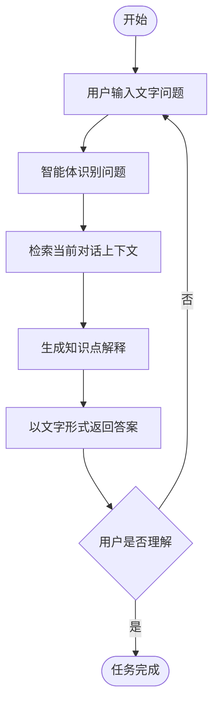
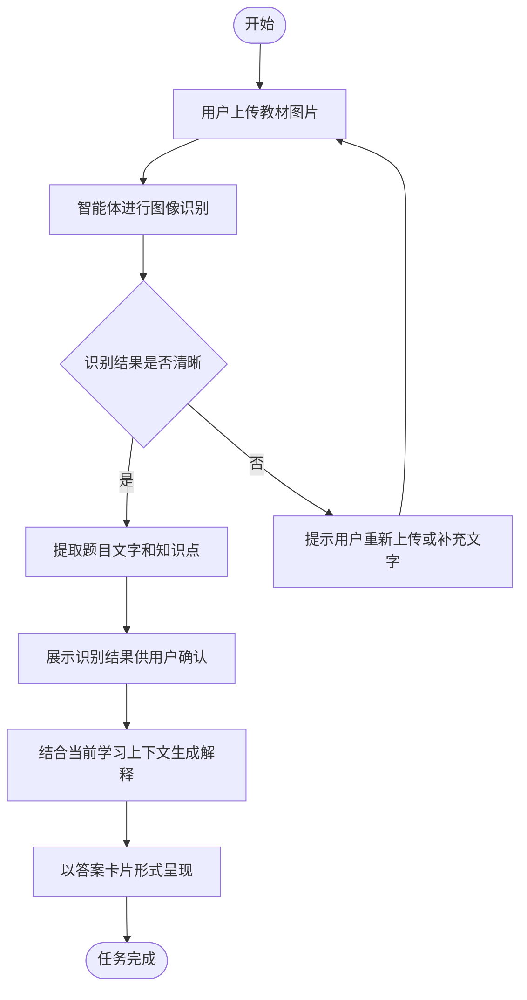
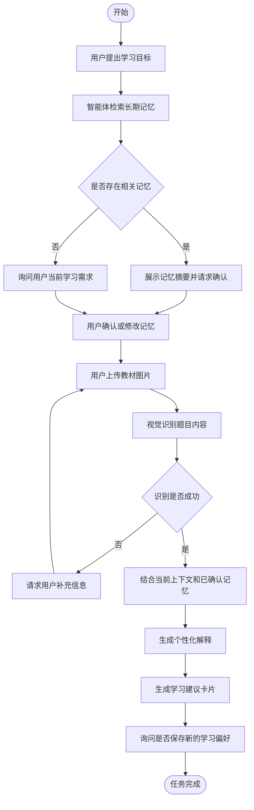

# 进阶实验 A：多模态低保真原型与 0–4 级可用性测试

## 一、实验基本信息

**实验名称：** 多模态低保真原型与可用性测试（Pilot Usability Testing）

**参考案例：** Stanford CS147 A5

**实验场景：** 大学生学习辅助智能体

### 1. 实验目标

在接入复杂多模态工作流之前，通过低保真原型模拟智能体的文字、图片和卡片交互，开展先导可用性测试，提前发现交互过程中的问题。

重点考察：
- 不同复杂程度的任务能否顺利完成。
- 智能体能否正确识别用户的文字和图片输入。
- 智能体能否在适当时机调用历史记忆。
- 用户能否理解智能体的提示信息和交互反馈。

根据测试中发现的问题，优化记忆触发时机或交互提示语。

### 2. 实验对象与方法

**实验对象：** 2 名同学（测试者 A、测试者 B）。

**实验方法：**
1. 采用低保真原型模拟智能体的交互过程。
2. 为测试者提供三个不同复杂程度的任务。
3. 采用 Think-aloud（出声思维法），要求测试者在操作过程中说出自己的想法、判断和困惑。
4. 观察并记录关键事件（Critical Incidents）。
5. 按照 0–4 级严重度标准评估问题。
6. 根据测试结果提出交互优化方案。

## 二、低保真原型设计

### 任务流一：简单任务——文字提问

**任务描述：** 用户向学习辅助智能体询问一个知识点，智能体根据当前对话内容生成文字回答。

**用户目标：** 快速获得知识点解释。

**交互流程：**



**低保真界面示意：**

```text
┌──────────────────────────────┐
│       学习辅助智能体           │
├──────────────────────────────┤
│                              │
│ 用户：什么是短期记忆？          │
│                              │
│ 智能体：短期记忆是指智能体在     │
│ 当前交互过程中暂时保留的信息，   │
│ 用于理解上下文和维持对话连续性。 │
│                              │
│ ──────────────────────────── │
│ [请输入你的问题……]       [发送] │
└──────────────────────────────┘
```

**预期结果：** 用户能够通过文字输入问题，并获得与问题相关的回答，整个过程不需要额外操作。

### 任务流二：中等任务——图片辅助学习

**任务描述：** 用户上传教材题目图片，要求智能体解释其中的知识点。智能体需要识别图片内容，并结合用户当前的学习情境生成回答。

**用户目标：** 通过图片输入获得针对性的学习解释。

**交互流程：**



**低保真界面示意：**

```text
┌──────────────────────────────┐
│       学习辅助智能体           │
├──────────────────────────────┤
│ 用户：帮我解释这道题。          │
│                              │
│       [教材题目图片]            │
│                              │
│ 智能体：已识别图片内容：         │
│                              │
│ 题目：请解释短期记忆与长期记忆   │
│ 的区别。                       │
│                              │
│ [识别正确]       [重新上传]     │
│                              │
│ ┌──────────────────────────┐ │
│ │ 知识点卡片                 │ │
│ │ 短期记忆：当前任务上下文    │ │
│ │ 长期记忆：跨会话保存的信息  │ │
│ │                          │ │
│ │       [展开详细解释]       │ │
│ └──────────────────────────┘ │
└──────────────────────────────┘
```

**预期结果：** 智能体能够识别图片中的题目，在识别结果不确定时主动请求用户确认，避免因图像识别错误而产生不相关的回答。

### 任务流三：复杂任务——连续学习与长期记忆

**任务描述：** 用户希望智能体根据自己之前的学习情况提供个性化帮助。用户先提出学习目标，再上传教材图片并进行追问。智能体需要判断是否应该调用历史记忆，并结合当前对话生成个性化建议。

**用户目标：** 获得能够结合历史学习偏好的连续性服务。

**交互流程：**



**低保真界面示意：**

```text
┌──────────────────────────────┐
│       学习辅助智能体           │
├──────────────────────────────┤
│ 用户：帮我复习之前学过的知识点。 │
│                              │
│ 智能体：我检索到以下学习偏好：   │
│                              │
│ ┌──────────────────────────┐ │
│ │ 历史记忆确认卡片           │ │
│ │ 学习方式：喜欢结合例子理解  │ │
│ │ 回答偏好：先解释概念再举例  │ │
│ │                          │ │
│ │ [确认使用]   [修改记忆]    │ │
│ └──────────────────────────┘ │
│                              │
│ 用户：[上传教材图片]           │
│ 用户：结合之前的学习方式解释。  │
│                              │
│ 智能体：根据你确认的学习偏好， │
│ 我将先解释概念，再结合图片中的 │
│ 例题进行说明。                 │
│                              │
│ ┌──────────────────────────┐ │
│ │ 个性化学习建议卡片         │ │
│ │ ① 核心概念                 │ │
│ │ ② 例题解析                 │ │
│ │ ③ 易错点总结               │ │
│ └──────────────────────────┘ │
└──────────────────────────────┘
```

**预期结果：** 智能体能够根据用户确认的历史记忆调整回答方式，同时避免未经确认就调用可能过时或不准确的个人信息。

## 三、先导可用性测试设计

### 1. 测试任务

| 测试任务 | 复杂程度 | 测试重点 |
|---|---|---|
| 任务一：输入知识点问题并获取解释 | 简单 | 文字输入与回答是否顺畅 |
| 任务二：上传教材图片并请求解释 | 中等 | 图片识别与反馈机制 |
| 任务三：结合历史学习偏好完成连续学习 | 复杂 | 长期记忆调用与确认机制 |

### 2. 测试方法

邀请两名同学分别体验三个任务流。

测试过程中采用 Think-aloud（出声思维法），要求测试者边操作边表达自己的想法，例如：
- 我现在知道应该点击哪里吗？
- 我能理解智能体的提示吗？
- 我是否知道智能体为什么调用这条历史记忆？
- 如果识别结果错误，我知道该如何处理吗？

测试者独立完成任务，观察者不主动解释操作步骤，也不替测试者完成操作。

### 3. 关键事件严重度评分标准

| 等级 | 严重程度 | 判断标准 |
|---|---|---|
| 0 | 无问题 | 任务顺利完成，没有明显交互障碍 |
| 1 | 表面瑕疵 | 存在轻微视觉或表达问题，不影响任务完成 |
| 2 | 轻微可用性问题 | 用户出现短暂困惑，但能够自行解决 |
| 3 | 严重可用性问题 | 用户明显受阻，需要额外尝试才能完成任务 |
| 4 | 可用性灾难 | 用户无法完成任务，核心功能无法正常使用 |

## 四、关键事件日志与严重度评分

以下为关键事件记录表。实际测试时，应根据两名测试者的真实操作和口头反馈填写，不应将设计阶段的预期问题当作实际测试结果。

| 事件编号 | 对应任务 | 测试者 | 事件描述 | 事件性质 | 严重度 |
|---|---|---|---|---|---|
| #1 | 任务一 | 待记录 | 用户输入问题后顺利获得解释，能够理解回答内容 | 正向 | 待评估 |
| #2 | 任务二 | 待记录 | 用户上传图片后，对识别结果是否准确存在疑问 | 待观察 | 待评估 |
| #3 | 任务二 | 待记录 | 用户未能及时发现图片识别失败的提示，尝试继续操作 | 待观察 | 待评估 |
| #4 | 任务三 | 待记录 | 用户希望知道智能体为什么调用自己的历史学习偏好 | 待观察 | 待评估 |
| #5 | 任务三 | 待记录 | 用户对历史记忆的准确性或时效性产生疑问 | 待观察 | 待评估 |

### 关键事件记录要求

每次测试后补充以下信息：

1. 具体发生了什么？
2. 用户当时采取了什么操作？
3. 用户是否表达了困惑或不满？
4. 用户是否能够自行解决？
5. 该事件对任务完成造成了什么影响？

严重度应根据实际影响进行判断，而不是仅根据问题出现的次数进行判断。

## 五、交互优化方案

### 1. 发现的问题

在复杂任务中，智能体需要调用用户的长期记忆，以便根据历史学习偏好提供个性化服务。

但是，如果智能体直接调用历史记忆而不向用户说明，可能产生以下问题：

- 用户不知道智能体为什么采用某种回答方式。
- 历史偏好可能已经发生变化，导致个性化推荐不准确。
- 用户无法及时发现或纠正错误记忆。
- 记忆调用过程缺少透明度，降低用户对智能体的信任。

### 2. 优化前后对比

**优化前：直接调用历史记忆**

```text
用户：帮我复习这个知识点。

智能体：根据你之前的学习习惯，
我会先解释概念，再举例说明。
```

存在的问题：
- 没有告知用户具体调用了什么记忆。
- 没有确认历史偏好是否仍然有效。
- 用户缺少修改记忆的入口。

**优化后：增加记忆上下文确认卡片**

```text
用户：帮我复习这个知识点。

智能体：我检索到你之前的学习偏好：

┌────────────────────────────┐
│ 历史记忆确认                 │
│                            │
│ 你之前倾向于先理解概念，     │
│ 再结合具体例子进行学习。     │
│                            │
│ [确认使用]   [修改记忆]      │
└────────────────────────────┘

用户：确认使用。

智能体：好的，我会按照这个方式
为你解释知识点。
```

### 3. 优化效果预期

| 优化维度 | 优化前 | 优化后 |
|---|---|---|
| 记忆调用 | 自动调用历史记忆 | 展示记忆摘要后由用户确认 |
| 信息透明度 | 用户不清楚调用了什么 | 明确展示记忆内容 |
| 用户控制权 | 缺少修改入口 | 支持确认和修改 |
| 记忆准确性 | 可能使用过时信息 | 用户可以纠正历史偏好 |
| 用户体验 | 可能产生困惑 | 提高交互透明度和可控性 |

## 六、实验总结

本实验以大学生学习辅助智能体为应用场景，设计了文字提问、图片辅助学习和连续学习三个不同复杂程度的任务流，分别考察智能体的文字交互、多模态输入处理以及长期记忆调用能力。

通过低保真原型设计，可以在系统开发之前明确用户与智能体之间的交互过程，提前识别潜在的可用性问题。

其中，长期记忆虽然能够提高智能体服务的连续性和个性化程度，但不合理的记忆调用也可能造成信息误用和用户困惑。因此，智能体不应只关注记忆能力本身，还应重视记忆调用的透明度、准确性和用户控制权。

本实验提出在长期记忆调用过程中增加记忆上下文确认卡片，使用户能够查看、确认和修改历史偏好，从而改善交互体验。

**实验结论：** 良好的智能体交互设计不仅需要实现多模态信息处理和长期记忆调用，还需要通过可用性测试不断发现交互断点，在智能体自动化能力与用户自主控制之间取得平衡。

---

## 七、实验附件：实际测试记录

完成两名同学的实际走查后，补充以下记录。

| 项目 | 测试者 A | 测试者 B |
|---|---|---|
| 任务一是否完成 | 待填写 | 待填写 |
| 任务二是否完成 | 待填写 | 待填写 |
| 任务三是否完成 | 待填写 | 待填写 |
| 遇到的主要问题 | 待填写 | 待填写 |
| 用户提出的改进建议 | 待填写 | 待填写 |

**测试记录说明：** 本文中的任务流、低保真界面及优化方案属于设计阶段成果；关键事件的最终描述和严重度评分应以实际参与者的测试观察为依据。
